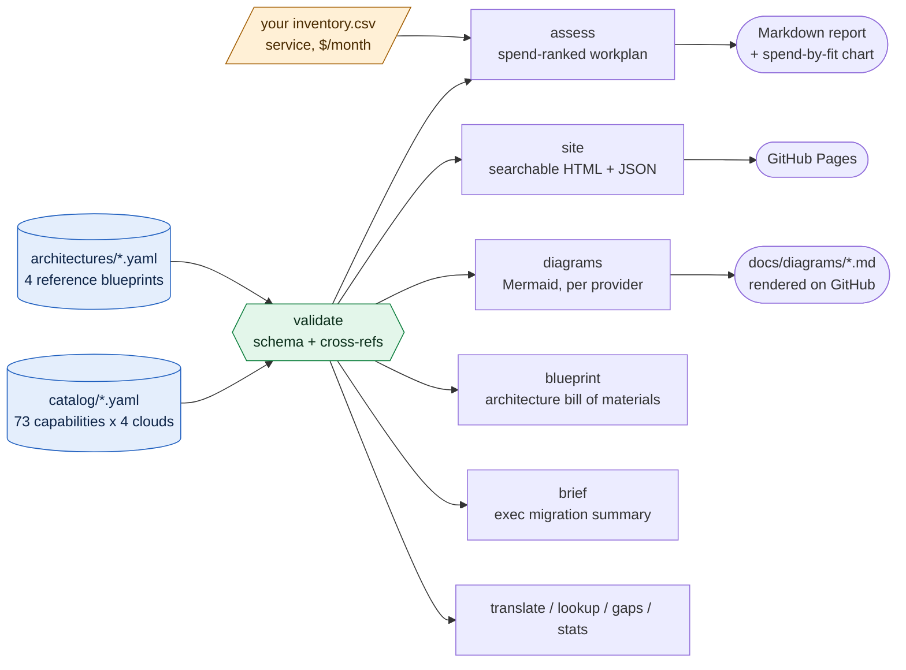
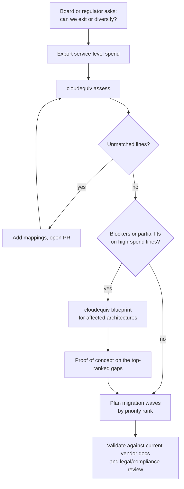

# Cloud Equivalency Catalog

**A machine-readable map of equivalent services across AWS, Azure, Google Cloud and Oracle Cloud, plus the tooling to use it on a real estate: translate services, draw architectures, and turn a real service inventory into a spend-ranked migration workplan.**

Multi-cloud strategy, exit planning, regulator "stressed exit" reviews and sovereignty decisions all start with: *what is the equivalent of X on the other cloud, and what do we lose?* This repo answers it as validated data (YAML), not a slide deck that goes stale.

> **Read this first.** Fit ratings and risk levels are curated judgments, not vendor statements or benchmarks. Product names and features change constantly; this catalog was authored from knowledge current to mid-2026 and has **not** been re-verified against live vendor documentation. Parity scores are a heuristic over this catalog's own capability list, not a ranking of providers. Sovereign/government entries describe categories of offering, **not authorizations**: check the FedRAMP Marketplace, DoD, or your regulator directly. Spend figures in `examples/` are illustrative. Not affiliated with any cloud vendor.

## How it fits together



## Try it in 2 minutes

```bash
pip install -e ".[dev]"
cloudequiv validate
cloudequiv assess examples/bank-aws-inventory.csv --to azure      # real-world style report
cloudequiv blueprint regulated-data-platform --from aws --to oci  # whole-architecture view
cloudequiv translate "DynamoDB" --to azure
./labs/run_all.sh                                                 # everything, end to end
```

### 1. Assess a real inventory (the headline feature)

Give it a service-level cost export (`service,monthly_cost_usd,workload`) and it returns a **priority-ranked workplan**: priority = spend x (how poor the fit is + how hard the move is). The bundled illustrative bank estate (43 lines, about $1.35M/month on AWS) produces output like:

```text
# Migration assessment: AWS -> Azure
- Monthly spend in inventory: $1,348,000; matched to catalog: $1,300,000 (96%)
- Spend with only a partial or no equivalent on target: $47,000 (3%)
- Spend that is high-complexity and not an exact match: $142,000 (11%)
| # | Source service  | $/mo     | Target service                     | Fit   | Complexity | Lock-in |
| 1 | Amazon Aurora   | $142,000 | Azure SQL Hyperscale / Azure ...   | close | high       | high    |
| 2 | Amazon Redshift | $128,000 | Microsoft Fabric Warehouse / ...   | exact | high       | high    |
...
Unmatched: Amazon Quantum Ledger Database, AWS Mainframe Modernization
```

The report embeds a Mermaid pie of spend by fit, and lists unmatched lines honestly instead of guessing. Works from any source: `--from aws|azure|gcp|oci`.

### 2. See the architecture, not just the services

Four reference blueprints (`three-tier-web`, `regulated-data-platform`, `event-driven-payments`, `gov-hybrid-enclave`) are drawn once per provider with every node colored **and labeled** by fit (green exact, blue close, amber partial, red dashed none). Committed pages render natively on GitHub:

| Architecture | Diagrams |
|---|---|
| Internet-facing three-tier web app | [docs/diagrams/three-tier-web.md](docs/diagrams/three-tier-web.md) |
| Regulated bank data platform | [docs/diagrams/regulated-data-platform.md](docs/diagrams/regulated-data-platform.md) |
| Event-driven payments | [docs/diagrams/event-driven-payments.md](docs/diagrams/event-driven-payments.md) |
| Federal hybrid enclave | [docs/diagrams/gov-hybrid-enclave.md](docs/diagrams/gov-hybrid-enclave.md) |

Rendered snapshots are in [`docs/diagrams/img/`](docs/diagrams/img/). The Mermaid source is authoritative, and CI fails if it goes stale (`cloudequiv diagrams --check`). Print any diagram: `cloudequiv diagram regulated-data-platform --provider oci`.

### 3. Hands-on labs

| Lab | You will | Time |
|---|---|---|
| [01 Translate & find gaps](labs/01-translate-and-search.md) | Answer "what's the Azure equivalent, and what do we lose?" | 10 min |
| [02 Assess a real inventory](labs/02-assess-a-real-inventory.md) | Rank an exit workplan by spend and risk; run it on your own billing export | 20 min |
| [03 Architecture blueprints](labs/03-architecture-blueprints.md) | Move a whole bank data platform; model your own system | 15 min |
| [04 CI gates & publishing](labs/04-ci-gates-and-publishing.md) | Break the data on purpose and watch the gates catch it; go live on Pages | 15 min |

`./labs/run_all.sh` runs every lab command and is also executed in CI.

### 4. Executive brief and everything else

```bash
cloudequiv brief --from aws --to oci     # parity, blockers, rework, hard migrations, lock-in hotspots
cloudequiv gaps oci                      # where a provider is partial or none
cloudequiv stats                         # coverage and parity per provider
cloudequiv matrix --category security --format markdown   # also csv, json
cloudequiv site --out site               # searchable site + catalog.json
```

## Decision flow this supports



## The data format

```yaml
- id: object-storage
  name: Object storage
  description: Durable, API-accessed storage for unstructured data at any scale.
  migration_complexity: low        # low | medium | high
  lock_in_risk: low                # low | medium | high
  exec_note: S3 API compatibility is widespread; egress fees dominate exit cost.
  offerings:
    aws:   {service: Amazon S3,          fit: exact}
    azure: {service: Azure Blob Storage, fit: exact}
    gcp:   {service: Cloud Storage,      fit: exact}
    oci:   {service: OCI Object Storage, fit: exact, notes: "S3-compatible API endpoint."}
```

Rules enforced by `cloudequiv validate`: all four providers present; enums valid; unique IDs; **`partial` and `none` require `notes`**; every architecture component references a real capability and every edge a real component. A JSON Schema is in `schema/catalog.schema.json`.

```python
from cloudequiv.loader import load_entries
from cloudequiv import query, assess

entries = load_entries()
for r in query.translate(entries, "Cosmos DB", src="azure", dst="aws"):
    print(r["concept"], "->", r["to"]["service"], r["to"]["fit"])

report = assess.assess(entries, assess.read_inventory("examples/bank-aws-inventory.csv"), "aws", "oci")
print(report["at_risk"], "USD/month on partial or no equivalent")
```

## Publish it live (GitHub Pages)

1. `git init && git add . && git commit -m "Initial commit" && gh repo create cloud-equivalency-catalog --public --source=. --push`
2. **Settings -> Pages -> Source: GitHub Actions.** Pushes touching `catalog/` or `src/` validate and republish the searchable site.
3. CI runs validation, diagram freshness, tests and all labs on every PR. A monthly workflow opens a catalog-review issue.

## Layout

```
catalog/         YAML capability mappings, one file per category
architectures/   reference blueprints (components + edges referencing catalog ids)
examples/        illustrative bank AWS inventory
labs/            four hands-on labs + run_all.sh
docs/diagrams/   generated Mermaid pages + rendered PNG snapshots
schema/          JSON Schema
src/cloudequiv/  loader/validator, query, assess, architectures, renderers, CLI, site
tests/           26 tests: data integrity, validators, matching, diagrams, CLI
.github/         CI, Pages deploy, monthly review reminder
```

## Roadmap

Per-entry vendor-doc links and last-verified dates, FOCUS-format billing import, Terraform resource-type crosswalk, IBM Cloud and Alibaba Cloud, and a regulator crosswalk (DORA, FFIEC, FedRAMP families). See [CONTRIBUTING.md](CONTRIBUTING.md). MIT licensed.
