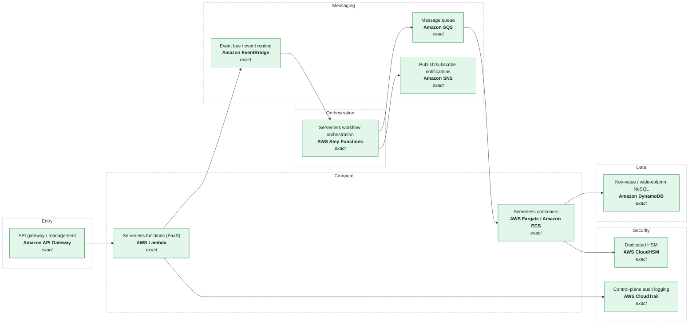
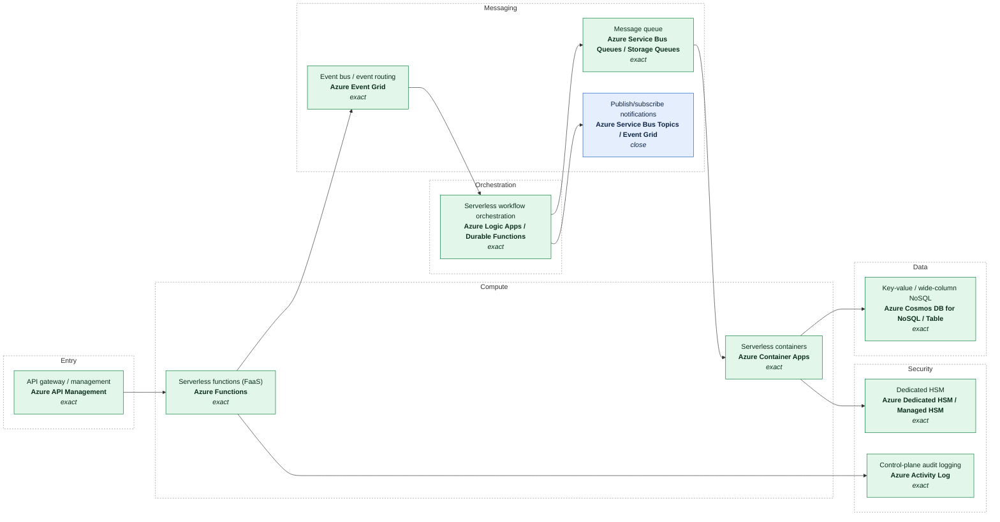
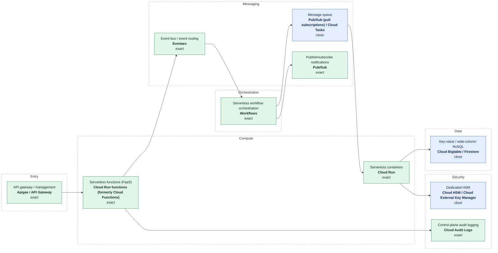
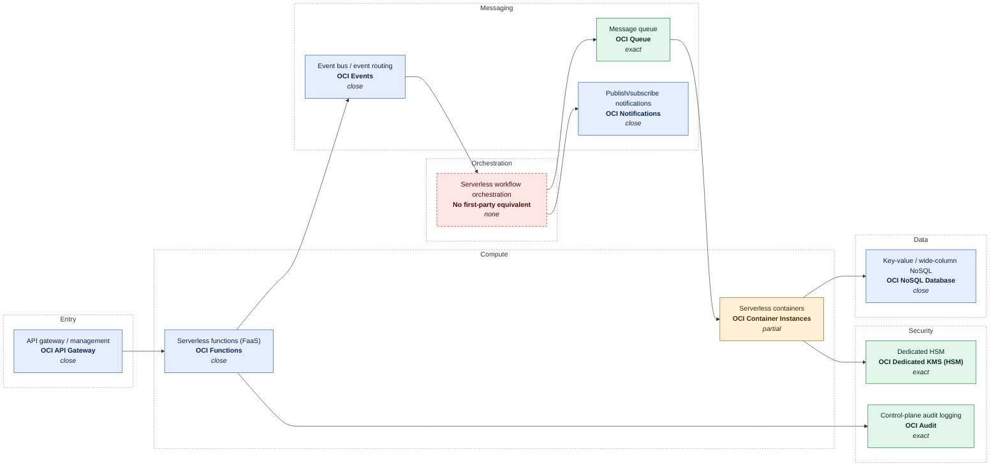

# Event-driven payments processing

API-fronted, event-driven payment flow with orchestration, HSM-backed signing and low-latency NoSQL state.

Node color = how well that provider's service matches the reference capability: green `exact`, blue `close`, amber `partial`, red dashed `none`. The label repeats the fit as text.

| Provider | Parity for this architecture |
|---|---|
| AWS | 100.0 / 100 |
| Azure | 97.5 / 100 |
| Google Cloud | 92.5 / 100 |
| Oracle Cloud | 71.5 / 100 |

## AWS

## Azure

## Google Cloud

## Oracle Cloud

