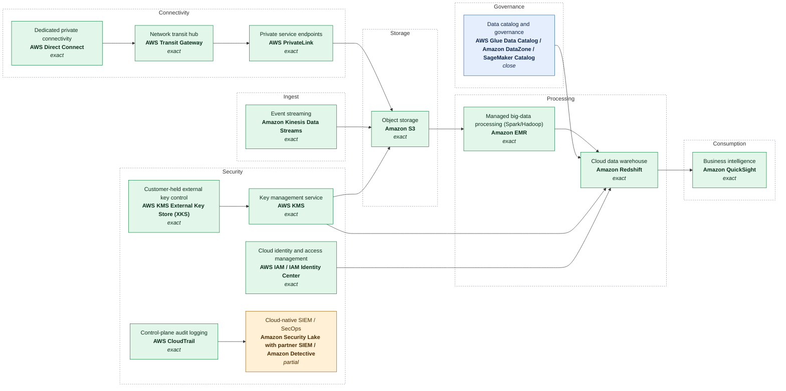
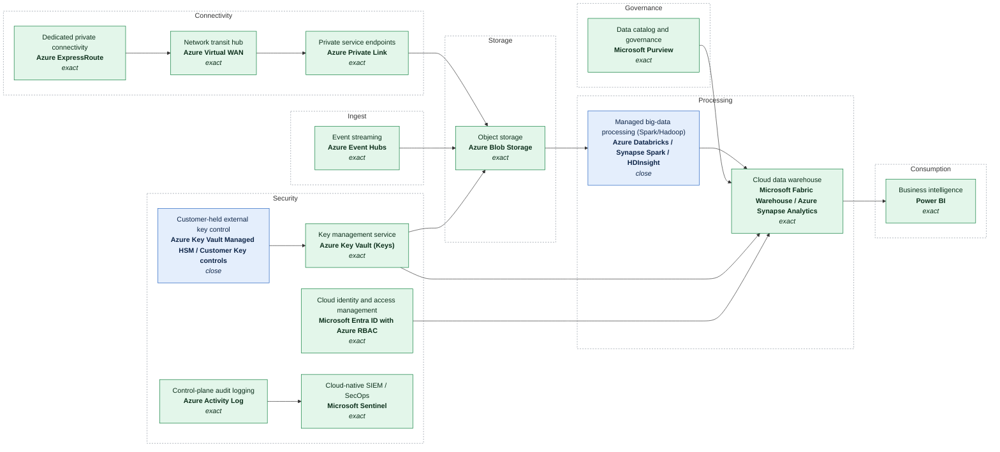
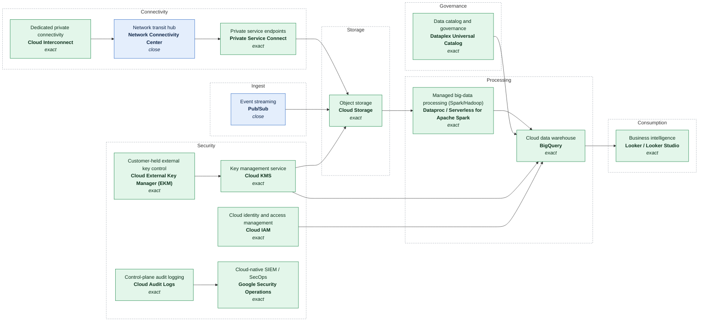
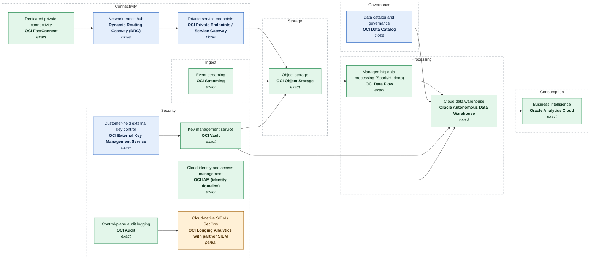

# Regulated bank data and analytics platform

Private-connected analytics platform with customer-held keys, governed data and security analytics, the shape regulators scrutinize in exit-plan reviews.

Node color = how well that provider's service matches the reference capability: green `exact`, blue `close`, amber `partial`, red dashed `none`. The label repeats the fit as text.

| Provider | Parity for this architecture |
|---|---|
| AWS | 93.9 / 100 |
| Azure | 96.4 / 100 |
| Google Cloud | 96.4 / 100 |
| Oracle Cloud | 88.6 / 100 |

## AWS

## Azure

## Google Cloud

## Oracle Cloud

