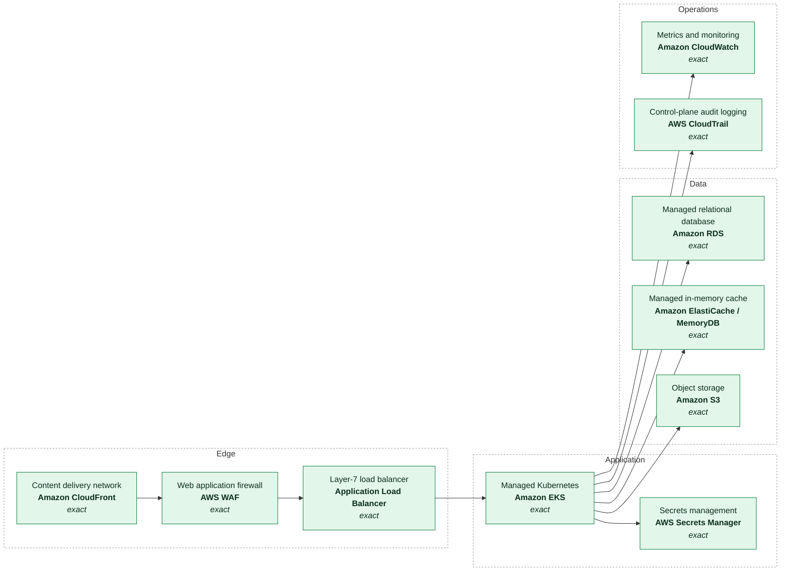
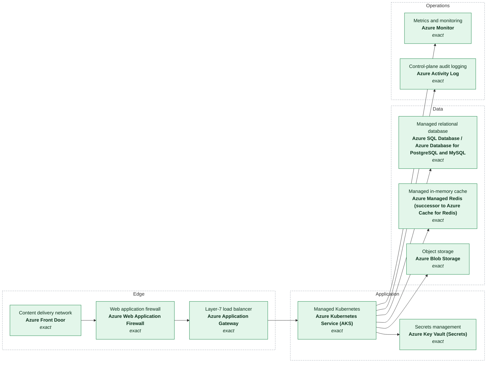
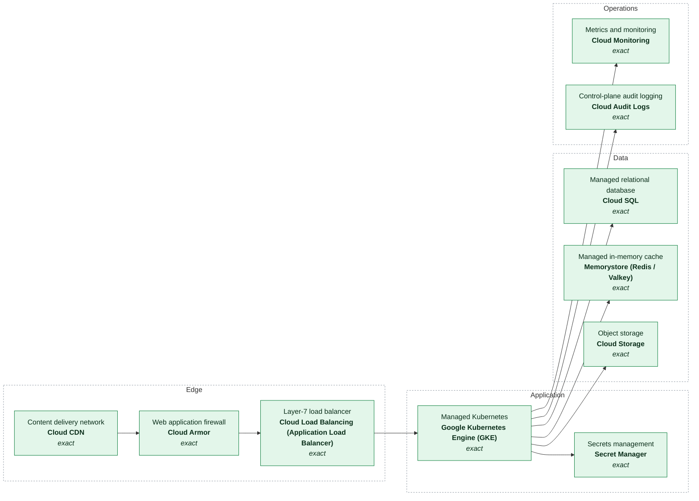
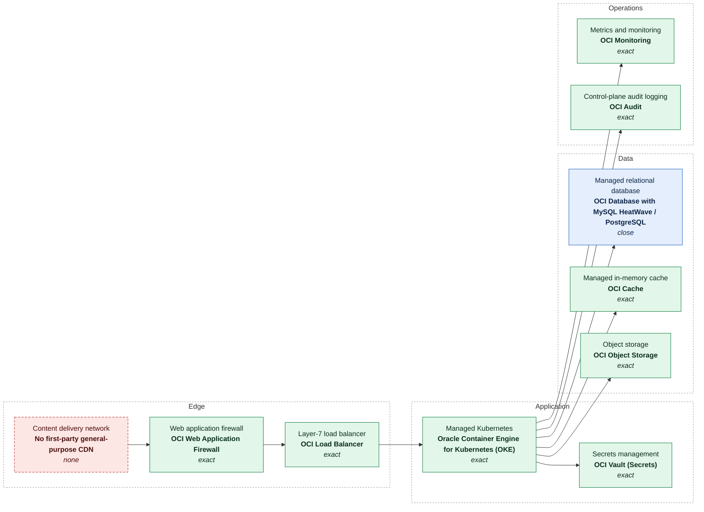

# Internet-facing three-tier web application

Customer-facing web platform with edge protection, containerized services, managed data stores and secrets.

Node color = how well that provider's service matches the reference capability: green `exact`, blue `close`, amber `partial`, red dashed `none`. The label repeats the fit as text.

| Provider | Parity for this architecture |
|---|---|
| AWS | 100.0 / 100 |
| Azure | 100.0 / 100 |
| Google Cloud | 100.0 / 100 |
| Oracle Cloud | 87.5 / 100 |

## AWS

## Azure

## Google Cloud

## Oracle Cloud

