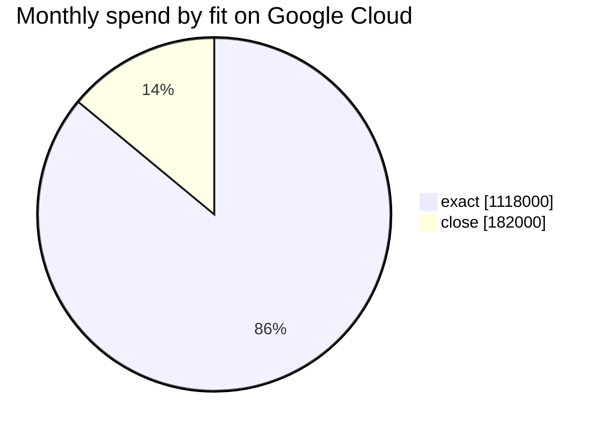

# Migration assessment: AWS -> Google Cloud

- Inventory lines: **43** (41 matched, 2 unmatched)
- Monthly spend in inventory: **$1,348,000**; matched to catalog: **$1,300,000** (96%)
- Spend with only a **partial or no** equivalent on target: **$0** (0%)
- Spend that is **high-complexity and not an exact match**: **$124,000** (9%)

## Priority-ranked workplan
Priority = monthly spend x (fit gap + migration complexity). Start at the top: it is where money and risk concentrate.

| # | Source service | Workload | $/mo | Target service | Fit | Complexity | Lock-in | Notes |
|---|---|---|---|---|---|---|---|---|
| 1 | Amazon Aurora | payments ledger | $142,000 | AlloyDB for PostgreSQL | exact | high | high | Wire-compatible, but performance features, replication and tooling are proprietary. |
| 2 | Amazon Redshift | enterprise warehouse | $128,000 | BigQuery | exact | high | high | SQL dialect, stored logic and ecosystem integrations drive cost; data is portable, pipelines are not. |
| 3 | Amazon DynamoDB | session and idempotency state | $61,000 | Cloud Bigtable / Firestore | close | high | high | Data models and access patterns are proprietary; plan application rewrite. |
| 4 | Amazon SageMaker | fraud models | $76,000 | Vertex AI | exact | high | high | Pipelines, feature stores and model registries are proprietary; models themselves (ONNX, PyTorch) are portable. |
| 5 | Amazon RDS for PostgreSQL | customer master | $96,000 | Cloud SQL | exact | medium | low | Standard engines migrate with native tooling; the risk is in extensions, versions and operational tooling. |
| 6 | Amazon EC2 | core banking batch + legacy apps | $184,000 | Compute Engine | exact | low | low | Commodity capability; the lift is in images, licensing and networking, not the VM itself. |
| 7 | AWS Glue | ETL | $39,000 | Dataflow / Cloud Data Fusion | close | high | high |  |
| 8 | Amazon EKS | digital channels | $54,000 | Google Kubernetes Engine (GKE) | exact | medium | medium | Kubernetes API is portable; ingress, IAM integration, storage classes and networking plugins are not. |
| 9 | Amazon EMR | risk model batch | $52,000 | Dataproc / Serverless for Apache Spark | exact | medium | low |  |
| 10 | AWS Lambda | event glue and notifications | $33,000 | Cloud Run functions (formerly Cloud Functions) | exact | high | high | Triggers, bindings, IAM and event payload formats are proprietary; expect rewrite of glue code. |
| 11 | AWS CloudHSM | card PIN and signing keys | $24,000 | Cloud HSM / Cloud External Key Manager | close | high | medium |  |
| 12 | Amazon CloudWatch | observability | $31,000 | Cloud Monitoring | exact | medium | medium |  |
| 13 | Amazon Bedrock | agent assist | $29,000 | Vertex AI (Model Garden / Gemini) | exact | medium | high | Model availability differs sharply by provider and region; prompts, guardrails and evaluation sets need re-validation after any move. |
| 14 | Amazon Kinesis Data Streams | clickstream | $18,000 | Pub/Sub | close | medium | medium | Pub/Sub has no partition/offset model like Kafka-style logs. |
| 15 | Amazon S3 | data lake landing zone | $48,000 | Cloud Storage | exact | low | low | S3 API compatibility is widespread; data egress fees, not technology, dominate exit cost. |
| 16 | Amazon MSK | transaction streaming | $47,000 | Managed Service for Apache Kafka | exact | low | low |  |
| 17 | AWS Fargate | internal APIs | $21,000 | Cloud Run | exact | medium | medium |  |
| 18 | AWS Step Functions | loan origination workflow | $14,000 | Workflows | exact | high | high | Workflow definition languages are proprietary and embed service integrations; treat as a rewrite. |
| 19 | Amazon EBS | VM volumes | $37,000 | Persistent Disk / Hyperdisk | exact | low | low |  |
| 20 | Amazon EFS | shared batch files | $12,000 | Filestore | close | medium | low | NFS only; SMB needs NetApp Volumes or third-party. |
| 21 | Amazon QuickSight | exec dashboards | $11,000 | Looker / Looker Studio | exact | high | high |  |
| 22 | AWS Direct Connect | data center links | $16,000 | Cloud Interconnect | exact | medium | low |  |
| 23 | AWS Backup | backups | $10,000 | Backup and DR Service | close | medium | medium |  |
| 24 | AWS Network Firewall | egress inspection | $13,000 | Cloud Next Generation Firewall | exact | medium | medium |  |
| 25 | Amazon CloudFront | online banking edge | $22,000 | Cloud CDN | exact | low | low |  |
| 26 | AWS Transit Gateway | network hub | $7,000 | Network Connectivity Center | close | medium | medium |  |
| 27 | AWS Config | config compliance | $6,000 | Cloud Asset Inventory / Security Health Analytics | close | medium | medium |  |
| 28 | AWS WAF | web protection | $9,000 | Cloud Armor | exact | medium | medium |  |
| 29 | Amazon EventBridge | domain events | $6,000 | Eventarc | exact | high | high |  |
| 30 | Amazon GuardDuty | threat detection | $8,000 | Security Command Center (Event Threat Detection) | exact | medium | medium |  |
| 31 | Amazon Textract | KYC document intake | $8,000 | Document AI | exact | medium | medium |  |
| 32 | Amazon SQS | payment queues | $5,000 | Pub/Sub (pull subscriptions) / Cloud Tasks | close | medium | medium |  |
| 33 | AWS KMS | encryption keys | $6,000 | Cloud KMS | exact | medium | medium | Keys generated inside a managed KMS generally cannot be exported; plan key import or re-encryption. |
| 34 | AWS Security Hub | posture management | $5,000 | Security Command Center | exact | medium | medium |  |
| 35 | Amazon S3 Glacier | 7-year record retention | $9,000 | Cloud Storage Archive class | exact | low | low |  |
| 36 | AWS PrivateLink | private service access | $4,000 | Private Service Connect | exact | medium | medium |  |
| 37 | Amazon SNS | alerts fan-out | $3,000 | Pub/Sub | exact | medium | medium |  |
| 38 | AWS CloudTrail | audit trail | $4,000 | Cloud Audit Logs | exact | low | low | Examiners ask for this first. Confirm retention, immutability and export to your archive. |
| 39 | AWS Secrets Manager | app credentials | $2,000 | Secret Manager | exact | low | low |  |
| 40 | AWS CloudFormation | provisioning | $0 | Infrastructure Manager (Terraform-based) | partial | high | high | Deployment Manager is deprecated; Google's native path is managed Terraform rather than a proprietary template language. |
| 41 | AWS Organizations | account governance | $0 | Resource Manager organization / Organization Policy Service | exact | high | high | Hierarchy models differ (accounts vs subscriptions vs projects vs compartments); your org structure must be redesigned, not copied. |

## Unmatched inventory lines (not in catalog: review manually or contribute a mapping)

- Amazon Quantum Ledger Database ($3,000/mo)
- AWS Mainframe Modernization ($45,000/mo)

_Heuristic output from curated data. Validate with vendor documentation and a proof of concept before committing._
