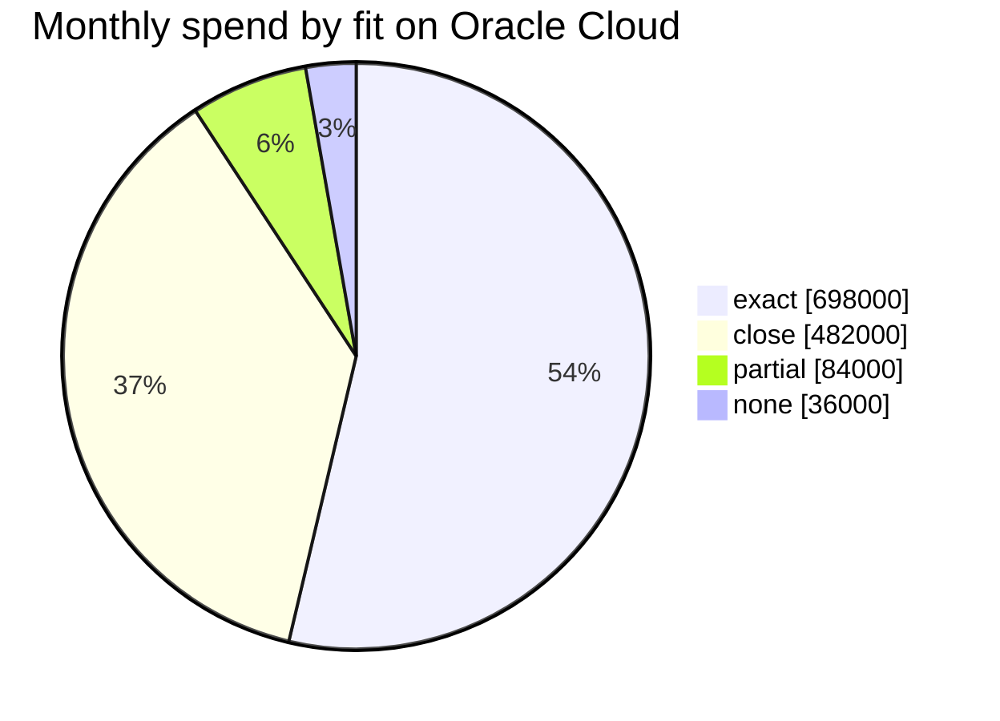

# Migration assessment: AWS -> Oracle Cloud

- Inventory lines: **43** (41 matched, 2 unmatched)
- Monthly spend in inventory: **$1,348,000**; matched to catalog: **$1,300,000** (96%)
- Spend with only a **partial or no** equivalent on target: **$120,000** (9%)
- Spend that is **high-complexity and not an exact match**: **$332,000** (25%)

## Priority-ranked workplan
Priority = monthly spend x (fit gap + migration complexity). Start at the top: it is where money and risk concentrate.

| # | Source service | Workload | $/mo | Target service | Fit | Complexity | Lock-in | Notes |
|---|---|---|---|---|---|---|---|---|
| 1 | Amazon Aurora | payments ledger | $142,000 | Oracle Autonomous Database | close | high | high | Oracle-engine-centric; different architecture and migration path. |
| 2 | Amazon Redshift | enterprise warehouse | $128,000 | Oracle Autonomous Data Warehouse | exact | high | high | SQL dialect, stored logic and ecosystem integrations drive cost; data is portable, pipelines are not. |
| 3 | Amazon SageMaker | fraud models | $76,000 | OCI Data Science | close | high | high | Pipelines, feature stores and model registries are proprietary; models themselves (ONNX, PyTorch) are portable. |
| 4 | Amazon RDS for PostgreSQL | customer master | $96,000 | OCI Database with MySQL HeatWave / PostgreSQL | close | medium | low | Strongest for Oracle and MySQL; SQL Server is generally run on Compute rather than as a managed service. |
| 5 | Amazon DynamoDB | session and idempotency state | $61,000 | OCI NoSQL Database | close | high | high | Data models and access patterns are proprietary; plan application rewrite. |
| 6 | Amazon EC2 | core banking batch + legacy apps | $184,000 | OCI Compute | exact | low | low | Commodity capability; the lift is in images, licensing and networking, not the VM itself. |
| 7 | Amazon MSK | transaction streaming | $47,000 | OCI Streaming with Kafka compatibility | partial | low | low | Kafka-compatible API on OCI Streaming, not a full Kafka cluster. |
| 8 | AWS Lambda | event glue and notifications | $33,000 | OCI Functions | close | high | high | Fn Project based; smaller trigger ecosystem. |
| 9 | AWS Glue | ETL | $39,000 | OCI Data Integration | exact | high | high |  |
| 10 | Amazon CloudFront | online banking edge | $22,000 | No first-party general-purpose CDN | none | low | low | Typically fronted by a partner CDN (e.g. Akamai) or a third-party provider. |
| 11 | Amazon EKS | digital channels | $54,000 | Oracle Container Engine for Kubernetes (OKE) | exact | medium | medium | Kubernetes API is portable; ingress, IAM integration, storage classes and networking plugins are not. |
| 12 | Amazon EMR | risk model batch | $52,000 | OCI Data Flow | exact | medium | low |  |
| 13 | AWS Step Functions | loan origination workflow | $14,000 | No first-party equivalent | none | high | high | Compose with OCI Functions and Events, or use an open-source orchestrator such as Temporal or Airflow. |
| 14 | AWS Fargate | internal APIs | $21,000 | OCI Container Instances | partial | medium | medium | Runs containers without nodes but lacks the scale-to-zero, revision and traffic-splitting model of Cloud Run or Container Apps. |
| 15 | Amazon Bedrock | agent assist | $29,000 | OCI Generative AI | close | medium | high | Smaller model catalog; verify required models and regions. |
| 16 | AWS CloudHSM | card PIN and signing keys | $24,000 | OCI Dedicated KMS (HSM) | exact | high | medium |  |
| 17 | Amazon CloudWatch | observability | $31,000 | OCI Monitoring | exact | medium | medium |  |
| 18 | Amazon S3 | data lake landing zone | $48,000 | OCI Object Storage | exact | low | low | Offers an S3-compatible API endpoint. |
| 19 | AWS Backup | backups | $10,000 | OCI volume/boot volume backups and database backup | partial | medium | medium | Per-service backup policies; no single cross-workload backup vault comparable to AWS Backup or Azure Backup. |
| 20 | Amazon EBS | VM volumes | $37,000 | OCI Block Volume | exact | low | low |  |
| 21 | Amazon EFS | shared batch files | $12,000 | OCI File Storage | close | medium | low | NFS focus; SMB support is more limited. |
| 22 | Amazon Kinesis Data Streams | clickstream | $18,000 | OCI Streaming | exact | medium | medium |  |
| 23 | Amazon QuickSight | exec dashboards | $11,000 | Oracle Analytics Cloud | exact | high | high |  |
| 24 | AWS Direct Connect | data center links | $16,000 | OCI FastConnect | exact | medium | low |  |
| 25 | AWS Config | config compliance | $6,000 | OCI Search / Cloud Guard detectors | partial | medium | medium | No single configuration-timeline and rule-evaluation service comparable to AWS Config. |
| 26 | AWS Network Firewall | egress inspection | $13,000 | OCI Network Firewall | exact | medium | medium | Built on a Palo Alto Networks engine. |
| 27 | Amazon EventBridge | domain events | $6,000 | OCI Events | close | high | high |  |
| 28 | Amazon GuardDuty | threat detection | $8,000 | OCI Threat Intelligence / Cloud Guard | close | medium | medium |  |
| 29 | AWS Transit Gateway | network hub | $7,000 | Dynamic Routing Gateway (DRG) | close | medium | medium |  |
| 30 | AWS WAF | web protection | $9,000 | OCI Web Application Firewall | exact | medium | medium |  |
| 31 | Amazon Textract | KYC document intake | $8,000 | OCI Document Understanding | exact | medium | medium |  |
| 32 | AWS Security Hub | posture management | $5,000 | OCI Cloud Guard / Security Zones | close | medium | medium |  |
| 33 | AWS KMS | encryption keys | $6,000 | OCI Vault | exact | medium | medium | Keys generated inside a managed KMS generally cannot be exported; plan key import or re-encryption. |
| 34 | AWS PrivateLink | private service access | $4,000 | OCI Private Endpoints / Service Gateway | close | medium | medium |  |
| 35 | Amazon SQS | payment queues | $5,000 | OCI Queue | exact | medium | medium |  |
| 36 | Amazon S3 Glacier | 7-year record retention | $9,000 | OCI Archive Storage | exact | low | low |  |
| 37 | Amazon SNS | alerts fan-out | $3,000 | OCI Notifications | close | medium | medium |  |
| 38 | AWS CloudTrail | audit trail | $4,000 | OCI Audit | exact | low | low | Examiners ask for this first. Confirm retention, immutability and export to your archive. |
| 39 | AWS Secrets Manager | app credentials | $2,000 | OCI Vault (Secrets) | exact | low | low |  |
| 40 | AWS CloudFormation | provisioning | $0 | OCI Resource Manager (managed Terraform) | partial | high | high | Managed Terraform service rather than a proprietary template language. |
| 41 | AWS Organizations | account governance | $0 | Tenancy compartments / Security Zones | close | high | high | Compartment model is simpler; fewer prebuilt landing-zone accelerators. |

## Unmatched inventory lines (not in catalog: review manually or contribute a mapping)

- Amazon Quantum Ledger Database ($3,000/mo)
- AWS Mainframe Modernization ($45,000/mo)

_Heuristic output from curated data. Validate with vendor documentation and a proof of concept before committing._
